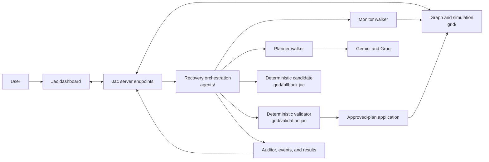
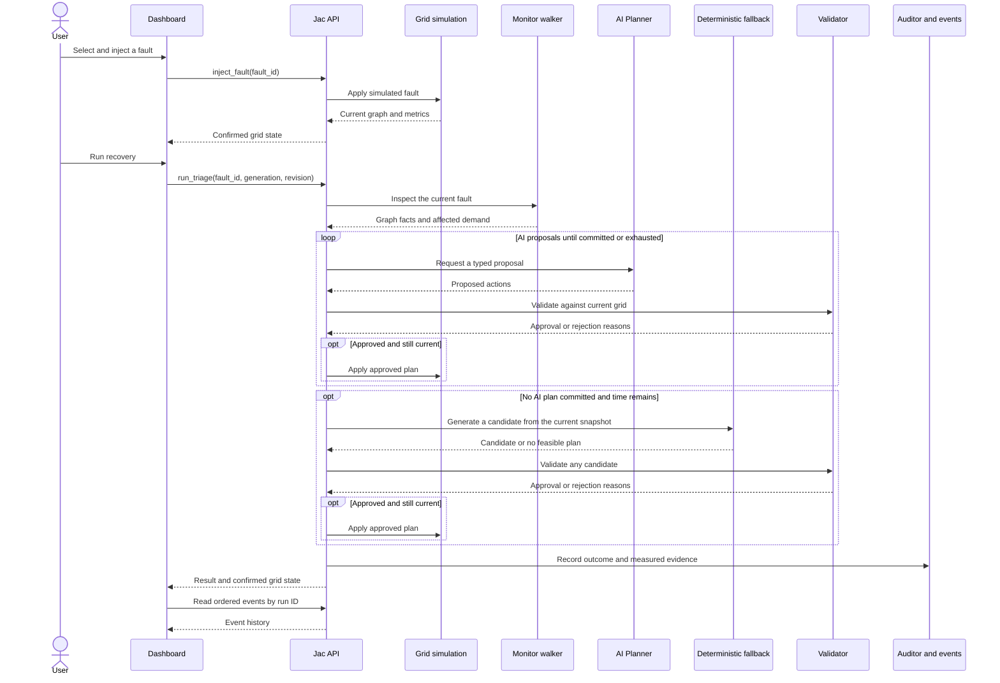

# GridWalk AI

GridWalk AI is a Jac web application for exploring recovery decisions in a fictional microgrid. Inject a fault, inspect the resulting network state, run a recovery, and see which actions were proposed, validated, and actually applied. The dashboard reports measured service before and after each run, including demand that remains unmet.

The governing rule is simple: **AI proposes; deterministic Jac code validates; the simulation applies only approved changes.** The application is a decision-support simulator, not a controller for real electrical equipment.

## What the application does

- Models a twelve-bus network with sources, prioritized loads, power lines, switches, and normally open ties.
- Provides three repeatable scenarios: reduced source capacity, a faulted line, and insufficient backup supply.
- Lets users inspect topology, component state, active faults, served demand, unmet demand, and critical-load preservation.
- Tries Gemini planning, then an independent Groq backup, then a deterministic candidate when AI planning does not commit a plan and time remains.
- Validates connectivity, source and line capacities, load priorities, and the current grid revision before any recovery action is committed.
- Shows ordered agent events, validator feedback, applied actions, execution mode, and a factual incident summary. Reset restores the healthy fixture.

The dashboard also includes fixed topology previews for exploring example states without changing the live simulation.

## Architecture



`shared/contracts.jac` defines the typed grid snapshots, recovery plans, validation results, events, and final outcomes exchanged between these modules. The server graph is authoritative; the client renders confirmed server state.

### Recovery path



Rejected, stale, or expired candidates leave the graph unchanged. A switch action cannot repair a physically faulted line. Recovery may preserve all critical loads while leaving some other demand unmet; the dashboard reports that as a partial outcome.

## Run locally

Use **Ubuntu on WSL 2** and the native **Jac 0.34.23** release. Work from a checkout in the WSL Linux filesystem for local server runs. The repository includes a pinned installer; [WSL setup](docs/WSL_Setup.md) covers the Windows-to-WSL workflow.

```bash
bash scripts/install_jac_wsl.sh
export PATH="$HOME/.local/bin:$PATH"
jac install
jac start main.jac --port 8011
```

Open `http://localhost:8011`. To use live AI planning, set `GOOGLE_API_KEY` and `GROQ_API_KEY` in an ignored `.env` file at the running project root; see [.env.example](.env.example). The deterministic fallback can still be attempted when provider planning does not produce an applied plan and the recovery deadline permits it.

## Project structure

| Path | Responsibility |
| --- | --- |
| `main.jac` | Registers server endpoints and mounts the dashboard |
| `client/` | Jac dashboard, topology, controls, and response decoding |
| `grid/` | Graph fixture, faults, allocation, validation, fallback, and application |
| `agents/` | Monitor, AI Planner, orchestration, Auditor, and run evidence |
| `shared/contracts.jac` | Typed contracts shared across the application |
| `tests/` | Fixed scenario and integration checks |
| `docs/` | WSL setup and local verification instructions |

## Verification and scope

From WSL, run `jac check . --nowarn` for a project-wide compiler check. The repository also includes Jac checks in `tests/` and the full setup verification command `bash scripts/verify_wsl.sh`.

The simulator uses a simplified, lossless kW allocation model. It does not model voltage, frequency, protection behavior, or equipment control. Recovery events are displayed after a run completes; they are not streamed as live progress.
