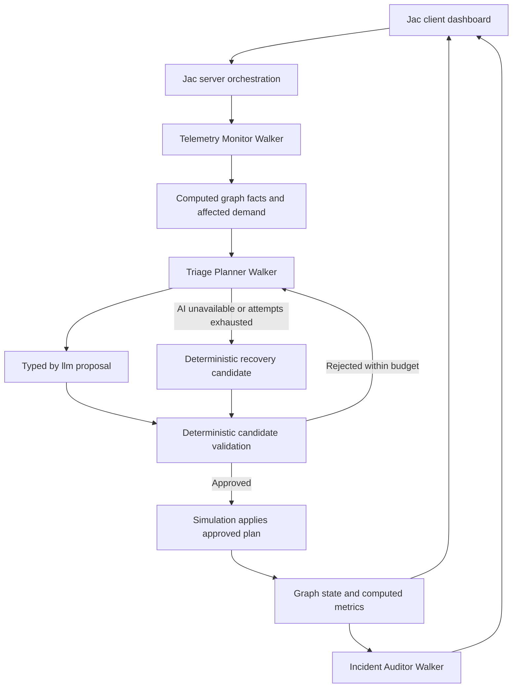

# GridWalk AI Development Guide

## 1. Development objective

Build a compact, full-stack Jac microgrid recovery decision-support simulator. A user injects a simulated fault, walkers inspect the affected graph, an AI Planner proposes recovery actions, deterministic code validates the candidate state, and the simulation applies only approved changes. The dashboard displays the topology, agent events, and measured recovery results.

The central invariant is:

**AI proposes. Deterministic Jac code validates. The simulation engine applies.**

This guide consolidates the final development direction. Details labeled **Open** or **Proposed** were not finalized in the planning discussion; ratify them before dependent implementation. Contract examples are design specifications, not tested Jac syntax or executable project code.

## 2. Scope and priorities

### P0 — Working vertical slice

- Initialize a fictional 10–15-node microgrid with sources, prioritized loads, and power lines.
- Inject source-capacity reduction and line faults.
- Traverse the graph with a Jac walker to identify affected demand.
- Generate a typed AI recovery proposal.
- Validate connectivity, source capacity, line capacity, and load priorities deterministically.
- Apply approved actions and recompute state and metrics.
- Expose a basic Jac dashboard with fault, recovery, and reset controls.
- Handle failure without applying an invalid plan or crashing the application.

### P1 — Final development target

- Planner revision using specific validator feedback.
- Ordered agent activity timeline.
- Incident Auditor report based on actual applied changes.
- Three reproducible core fault scenarios.
- Tested provider fallback and deterministic recovery fallback.

### P2 — Only after core functionality passes

- Additional nodes, animations, sophisticated metrics, and model-selection UI.
- Baseline comparison against deterministic recovery.
- Cloud deployment and a second fault during an in-flight recovery.

### Modeling boundary

- Use simplified connectivity and lossless kW allocation constraints.
- Do not claim AC/DC power-flow validation, voltage/frequency stability, protection coordination, transient simulation, or physical equipment control.
- A topology-valid allocation is not proof of real electrical safety.
- Battery reserve expressed in kW represents available power. Battery runtime requires a separate kWh/time model and is outside the agreed scope.
- Sample campus/facility names and values are fictional.

## 3. Stack and project organization

- **Language:** Jac for graph entities, simulation, walkers, validation, AI integration, and client components.
- **AI integration:** `by llm()` with typed return objects and `sem` descriptions.
- **Client:** Jac client components; use SVG or simple connected nodes for topology visualization.
- **Application inference:** Gemini Flash family as primary; Groq or OpenAI as a separately tested backup provider.
- **Recovery fallback:** deterministic Jac logic through the same validator.
- **Hosting:** attempt Jac Hammer when the local application is stable; retain a local runnable path.
- **Code composition constraint:** at least 80% Jac. Avoid a large external React/TypeScript scaffold; keep supporting CSS/configuration minimal. Do not commit dependencies, generated builds, or credentials.

Record the installed Jac and plugin versions before implementation. Verify scaffolding, server-call conventions, configuration, and LLM options against that version. The original blueprint's code and configuration are not a verified starter implementation.

Logical module boundaries:

| Area | Owner | Responsibility |
|---|---|---|
| Graph and simulation | Member 1 | Entities, fixture, faults, allocation, validation, application, reset, metrics |
| Agents and LLM integration | Member 2 | Monitor, Planner, Auditor, typed plans, revisions, API handling, events |
| Client and deployment | Member 3 | Dashboard, client adapter, integration, deployment, local run instructions |
| Graph-state contract | Member 1 | Canonical shared graph projection |
| Recovery-plan contract | Member 2 | Canonical proposal and validation-feedback integration |
| Integration coordination | Member 3 | Cross-module smoke tests and usable application |

These are logical boundaries, not a prescribed directory tree. Use a layout supported by the installed Jac project structure. Shared types should have one authoritative definition rather than copied dictionaries.

## 4. Architecture



### State ownership

- The server graph is the source of truth.
- The client renders projections and requests operations; it does not decide authoritative service status.
- The Planner produces intentions, not committed graph mutations.
- Validation evaluates a candidate without changing authoritative state.
- Only the simulation core applies an approved plan.
- The Auditor explains recorded results; its text cannot override computed metrics.
- If optional tools are added to the Planner, use read-only inspection or candidate simulation. Do not expose unguarded authoritative-state mutation tools.

## 5. Graph model

Canonical entity and field names are **Open**. The blueprint used aliases such as `SubstationNode`/`Substation` and `LoadNode`/`LoadSector`; select one naming scheme and use it consistently.

| Entity | Required data and meaning |
|---|---|
| Source/substation node | Stable ID, display name, available capacity in kW, computed dispatched power/current allocation, operational status, and available backup power when modeled |
| Load-sector node | Stable ID, display name, nonnegative demand in kW, priority tier, computed served state and powered status |
| Power-line edge | Stable line ID, capacity in kW, physical fault flag, and switch ID/state |
| Fault/run record | Fault identity, affected entity, scenario parameters, run progress/outcome; exact persistence is Open |
| Proposal/event records | Typed intended actions, validation evidence, applied actions, execution mode, and ordered event summaries |

### Priority tiers

1. **Tier 1:** critical demand, such as a hospital or laboratory.
2. **Tier 2:** essential demand, such as servers or essential services.
3. **Tier 3:** noncritical demand that should be shed first.

Reject deliberate Tier 1 shedding. Prefer Tier 3 shedding before Tier 2. If the network cannot physically serve critical demand under the simplified model, report unmet critical demand and infeasibility rather than claiming successful recovery.

### Lines and switches

A physical line and its switch are different concepts. A minimal model may keep `switch_id` and switch state as edge attributes; a separate switch node is not required.

```text
conducting edge = healthy physical line AND closed switch
```

Closing a switch does not repair a faulted line. A tie between sources also cannot bypass every downstream broken line. The line-failure fixture must have a genuine alternative path if its expected result is restoration.

### Fixture requirements

- Use stable unique identifiers for sources, loads, lines, and switches.
- Label demand and capacity consistently in kW.
- Verify that the baseline graph and allocation are feasible.
- Include the backup source's existing local commitments when calculating spare supply.
- Define named, repeatable fault inputs and expected results.
- Reset must reproduce the same fixture and derived state.
- Exact node count, wiring, demands, capacities, and normally open switches are **Open**.

## 6. Deterministic simulation and validation

The validator checks the **complete candidate state**, not just the individual action payload or total grid supply.

### Required checks

1. **Structure:** payload matches the typed action schema and recognized action types.
2. **References:** every target exists and has the correct entity kind.
3. **Numbers:** demands, capacities, dispatch, and service values are valid and nonnegative where applicable.
4. **Fault/switch logic:** no conducting route uses an open or physically faulted edge.
5. **Connectivity:** every claimed served load has a valid conducting path from an available source.
6. **Source capacity:** no source exceeds its available output.
7. **Line capacity:** no edge transfer exceeds its own rating.
8. **Allocation consistency:** do not double-count backup supply or supply a load without conserving flow.
9. **Priority:** reject deliberate critical-load shedding and enforce the agreed shedding policy.
10. **State consistency:** invalid proposals do not mutate the graph; recheck current state before applying an approved candidate.

### Minimum arithmetic

```text
0 <= source_dispatch(s) <= available_capacity(s)
abs(line_transfer(e)) <= line_capacity(e)
0 <= served_kw(load) <= demand_kw(load)

At each junction:
    inflow + source_dispatch = outflow + served_demand

Across the simplified lossless grid:
    total_source_dispatch = total_served_demand
```

A possible backup transfer is bounded by tie capacity, the neighbor's remaining supply after commitments, and every route constraint. An unavailable route carries zero transfer.

### Application boundary

- Simulate candidate actions separately from authoritative state.
- Return explicit rejection reasons without applying rejected actions.
- Apply only an approved plan that still matches the current graph conditions.
- Recompute allocation, connectivity, statuses, and metrics after application.
- Retain physical fault state after rerouting service.
- If every candidate fails, retain the faulted state and report failure.

**Open:** allocation algorithm, whole-load shedding versus partial service, routing assumptions, numeric tolerance, all-or-nothing commit mechanics, stale-plan detection, and deterministic fallback ordering.

## 7. Agent workflow

### Telemetry Monitor Walker

- Traverse the graph and inspect source/load states and conducting paths.
- Calculate supply, demand, overloads, and affected or disconnected loads in code.
- Supply a factual snapshot to the Planner.
- Do not depend solely on source overload detection; line faults and isolated loads also matter.

### Triage Planner Walker

- Inspect affected loads and valid backup opportunities.
- Call `by llm()` for a typed action proposal and concise rationale.
- Send the proposal to Member 1's validator.
- On rejection, revise using specific failure evidence while the attempt budget remains.
- Never mutate authoritative graph state directly.

### Incident Auditor Walker

- Read the applied actions, final graph state, validation evidence, and before/after metrics.
- Summarize what failed, what changed, how much demand was shed/unmet, and whether critical service was preserved.
- Keep narrative claims consistent with recorded facts.
- If AI summarization fails after successful recovery, retain the valid graph update and return a factual non-AI summary.

### Revision and fallback sequence

```text
Monitor facts
  -> AI proposal
  -> deterministic validation
       approved -> apply -> recompute -> audit
       rejected -> specific feedback -> bounded revision
       attempts/API exhausted -> backup provider within run budget
       AI still unavailable -> deterministic candidate -> same validator
       no valid candidate -> preserve fault and report infeasibility
```

The Validator is deterministic code, separate from the three walker roles. A model may produce a valid first proposal. Do not manufacture a rejection; use explicitly labeled invalid-plan fixtures to test revision behavior.

Display concise action rationales and validation/tool results, not fabricated private model reasoning.

## 8. Shared contracts

The following shapes are **Proposed** minimum contracts. Exact field names, enums, input signatures, and response envelopes require agreement.

| Contract | Minimum content |
|---|---|
| `GridState` | Source, load, and line/switch projections; current faults; computed service and capacity metrics |
| `RecoveryPlan` | Fault ID, affected source/context, ordered typed actions, explanation |
| `ValidationResult` | Accepted/rejected result, specific reasons, candidate allocation/metrics needed for feedback |
| `RecoveryResult` | Outcome, execution mode, applied actions, before/after metrics, incident summary |
| `AgentEvent` | Actor, event type, concise evidence, outcome; sequence/time and run correlation are recommended |

Illustrative proposal retained from the discussion:

```json
{
  "fault_id": "FAULT-001",
  "affected_source": "SUB-A",
  "actions": [
    { "type": "SHED_LOAD", "target_id": "LOAD-04" },
    { "type": "CLOSE_SWITCH", "target_id": "SW-02" }
  ],
  "explanation": "Preserve critical demand within available capacity."
}
```

These IDs and actions are examples, not an adopted fixture or validated recovery. `SHED_LOAD` targets a load; `CLOSE_SWITCH` targets a switch. Use IDs rather than display names.

Use one typed shared definition. Typed output conversion is not a substitute for engineering validation.

## 9. Logical API

These names express responsibilities, not guaranteed REST routes or valid installed-version Jac signatures.

| Operation | Owner | Consumers | Behavior |
|---|---|---|---|
| `get_grid_state()` | Member 1 | Members 2 and 3 | Read graph projection and computed metrics |
| `inject_fault(fault_id)` | Member 1 | Member 3 | Apply the mapped fault scenario and return refreshed state |
| `validate_plan(plan)` | Member 1 | Member 2 | Evaluate without committing; return actionable evidence |
| `run_triage(fault_id)` | Member 2 | Member 3 | Orchestrate detection, planning, validation, revision, application, and audit |
| `get_agent_events()` | Member 2 | Member 3 | Read ordered activity events |
| `reset_simulation()` | Member 1 | Member 3 | Restore fixture and consistent run state |

An internal approved-plan application operation is also needed in Member 1's simulation core. Its exact name is **Open**. Member 2 calls it only after validation; the client must not bypass validation.

Choose installed-version server functions or walker entry points and keep one client adapter for their response envelope. Resolve event polling versus streaming, run correlation, reset semantics, duplicate requests, and stale results before integration.

## 10. Runtime AI configuration

- Select an accessible Gemini Flash model by an actual typed-output smoke test. No exact model ID is finalized.
- Test Groq or OpenAI as the backup provider; do not assume credentials or quota exist.
- Keep the selected provider/model in one configuration source.
- Confirm the correct API-key variable names and supported options for the installed adapter.
- Use `sem` descriptions for the LLM-visible function, parameters, return fields, and any tools. Docstrings are not the compiler-generated prompt.
- Return a typed object rather than an unconstrained dictionary or manually parsed prose.
- Keep demand/capacity arithmetic outside the LLM.
- Keep credentials server-side, outside source control, client bundles, and logs.
- Record provider/model, request latency, attempt, and outcome for troubleshooting.

### Bounded execution

Set and test:

- Per-request timeout.
- Output/schema retry limit.
- Plan revision limit.
- Provider-switch budget.
- Overall recovery deadline.

Count adapter/SDK retries inside the overall budget to avoid nested retries stalling a run. Exact values are **Open**.

Coding-tool subscriptions and application API access are separate resources. Do not assume Google AI Pro or Codex access supplies the running application with paid API quota.

Do not copy the supplementary review's claim that Gemini 2.5 Flash shut down on 16 October. The master document's official-source check did not support that claim. Verify current model access for the actual account rather than pinning an untested ID.

## 11. Dashboard requirements

### Layout

- Header with simulation/run state and AI, backup-provider, or deterministic mode.
- Metrics for critical demand served, shed demand, available source capacity, and active faults.
- Prominent topology view with labeled nodes and lines.
- Fault scenario selector, inject fault, run recovery, and reset controls.
- Agent timeline showing observations, proposals, validation decisions, revisions, application, and audit.
- Final incident summary and before/after metrics.

### Interaction states

- Ready.
- Running/busy.
- Proposal rejected and revising.
- Recovery complete.
- Infeasible recovery with unmet demand.
- API error and fallback mode.

Prevent conflicting actions while a run is active. Refresh server-derived state after mutations, and ensure old responses cannot overwrite newer state.

Retain the planned color direction: green powered, red fault, amber shed, blue rerouted. Add words/icons; color must not be the only status signal. A rerouted load does not imply the failed line or source has been repaired.

## 12. Metrics

Compute authoritative metrics in the simulation core.

| Metric | Definition |
|---|---|
| Critical demand preserved | `100 * served Tier 1 kW / total Tier 1 demand kW`; show N/A when denominator is zero |
| Shed demand | Demand deliberately disconnected by recovery actions |
| Total unmet demand | All unserved demand, including shedding and fault-disconnected demand |
| Available supply | Current source capacity, distinct from actual dispatch |
| Constraint compliance | Source/line violations and connectivity failures |
| Recovery evidence | Execution mode, elapsed time, proposal/revision count, applied action count |

Do not confuse the percentage of critical demand served with the percentage of critical facilities powered. Keep fault count visible after successful service rerouting.

## 13. Scenarios and tests

### Core scenarios

| Scenario | Expected behavior |
|---|---|
| Source capacity reduction | Detect deficit; propose reserve transfer and/or priority-aware shedding; validate capacity on every route |
| Distribution line failure | Faulted edge stops conducting; use a genuine alternative path or report stranded demand/infeasibility |
| Insufficient backup | Reject excess transfer; revise toward feasible shedding or report inability to preserve critical demand |

For each scenario, document the exact baseline, changed parameters, expected outcome, and whether the proposal is live AI, injected test data, or deterministic fallback. Numeric fixtures and exact kW targets are **Open**.

### Required checks

- [ ] Healthy graph produces no unnecessary recovery or shedding.
- [ ] Reset restores the same graph, switch/fault state, allocation, and metrics.
- [ ] All three scenarios have reproducible outcomes.
- [ ] Unknown IDs and unsupported action types are rejected without mutation.
- [ ] Tier 1 shedding is rejected.
- [ ] Source overload is rejected even if total grid capacity is sufficient.
- [ ] Line overload is rejected even if source capacity is sufficient.
- [ ] Open/faulted paths cannot falsely restore isolated loads.
- [ ] Backup commitments are not double-counted.
- [ ] Invalid proposal returns useful feedback and can be revised.
- [ ] Revision exhaustion terminates within the run budget.
- [ ] Malformed AI output, timeouts, and rate limits trigger bounded handling.
- [ ] Backup provider and deterministic fallback pass through the validator.
- [ ] If all options fail, the fault remains visible and recovery reports failure.
- [ ] Repeated clicks, reset/new faults during planning, and stale results cannot apply outdated actions.
- [ ] Auditor failure cannot undo a successful validated recovery.
- [ ] Dashboard busy/error/infeasible states match server outcomes.

Run Jac checks and relevant runtime tests after integration. A successful static check does not prove provider options, configuration, or remote calls work at runtime. Use fixed model outputs for repeatable validation/revision tests and separately test the real provider path.

## 14. Member deliverables

### Member 1 — Graph and Simulation Engineer

**Tools:** Codex primary, Antigravity backup.

- [ ] Define canonical graph entities and shared state projection.
- [ ] Build and verify the fictional fixture and reset operation.
- [ ] Implement source and line faults, connectivity, reserve allocation, and shedding.
- [ ] Implement deterministic candidate validation and specific rejection evidence.
- [ ] Apply approved changes and recompute metrics.
- [ ] Provide fault/reset/state APIs to Member 3 and validation/application integration to Member 2.
- [ ] Verify numeric results and infeasible/disconnected cases.

### Member 2 — Agents and AI Engineer

**Tools:** Codex primary, Antigravity backup.

- [ ] Implement Monitor, Planner, and Auditor walkers.
- [ ] Own the typed proposal schema and `sem` descriptions.
- [ ] Integrate proposal validation and feedback-driven revision.
- [ ] Implement bounded provider calls, backup handling, and deterministic fallback orchestration.
- [ ] Emit ordered factual events and final execution mode/results.
- [ ] Integrate `run_triage` and event reading with Member 3.
- [ ] Test malformed output, invalid plans, exhausted attempts, and all three recovery workflows with Member 1.

### Member 3 — Client, Integration, and Deployment Engineer

**Tool:** Antigravity primary.

- [ ] Initialize the Jac full-stack structure and shared client adapter.
- [ ] Build the dashboard against the agreed sample state while backend work proceeds.
- [ ] Implement topology, controls, metrics, event timeline, and incident summary.
- [ ] Connect server operations and handle busy/error/infeasible/fallback states.
- [ ] Coordinate frequent integrated smoke tests.
- [ ] Attempt early hosting without losing the local runnable path.
- [ ] Maintain accurate installation, configuration, and startup instructions.

## 15. Implementation order and integration gates

1. **Freeze foundations:** installed versions, schema ownership, fixture policy, logical APIs, and recovery budgets.
2. **Build the first slice in parallel:** Member 1 creates graph/fault/reset logic; Member 2 creates monitor and typed planning interface; Member 3 builds the dashboard from shared sample state.
3. **Integrate deterministic recovery:** fault injection → affected loads → validated candidate → graph update → visible metrics.
4. **Add AI:** connect typed proposals to the same validator/application boundary.
5. **Add real feedback:** specific rejection → bounded revision → approval or fallback.
6. **Complete visibility:** ordered events, Auditor summary, final result modes, and UI failure states.
7. **Verify:** three scenarios, failure branches, reset, concurrency/stale-state behavior, and optional hosted execution.
8. **Freeze features:** fix correctness and integration defects before optional work.

The retained team targets are first integration at 10:30 AM, a working vertical slice by about 11:00 AM, one integrated AI scenario by 12:30 PM, revision loop by 1:30 PM, full application flow by 2:30 PM, and feature freeze at 3:45 PM. Treat these as development targets, not reasons to skip checks.

Use small commits and feature branches. Spend five minutes each hour proving the modules still integrate. The relevant schema owner approves shared type changes before consumers adapt them.

## 16. Open decisions to resolve before dependent coding

- [ ] Map actual team members to the three ownership roles.
- [ ] Record installed Jac/plugin versions and supported project structure/configuration.
- [ ] Choose canonical entity/field names and status enums.
- [ ] Finalize 10–15-node fixture, capacities, demand, switches, and alternate paths.
- [ ] Define whole-load versus partial-service behavior and shedding order.
- [ ] Choose deterministic allocation/routing method and numeric tolerance.
- [ ] Ratify exact typed contracts, result/error envelopes, and operation signatures.
- [ ] Choose event polling/streaming and run correlation/order fields.
- [ ] Define duplicate-request, reset-during-run, stale-plan, and application semantics.
- [ ] Select and test primary model and backup provider with actual credentials.
- [ ] Set timeout, output retries, plan revisions, provider switches, and overall deadline.
- [ ] Document startup, secrets configuration, reset, and optional deployment steps for the verified environment.

Keep the core scope, three ownership boundaries, deterministic approval gate, and three scenario types fixed while resolving these details.

## 17. References for implementation

- [Jac documentation](https://jaclang.org/docs/latest)
- [Jac `by` and `sem` operators](https://docs.jaseci.org/reference/language/operators/)
- [Jac structured outputs](https://docs.jaseci.org/tutorials/ai/structured-outputs/)
- [Gemini model deprecation status](https://ai.google.dev/gemini-api/docs/deprecations)
- [Gemini API billing and access](https://ai.google.dev/gemini-api/docs/billing)
- [Jac Hammer documentation](https://docs.jachammer.ai)

Derived from the GridWalk AI project master document and final planning discussion. Exact examples remain provisional where marked; this file does not claim that the application has been implemented or tested.
